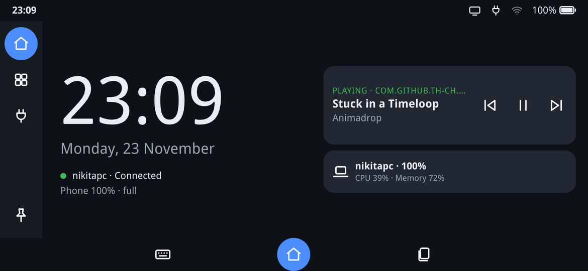
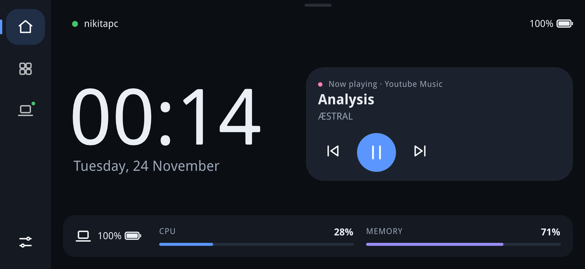
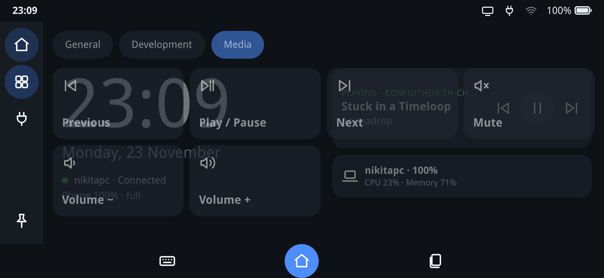
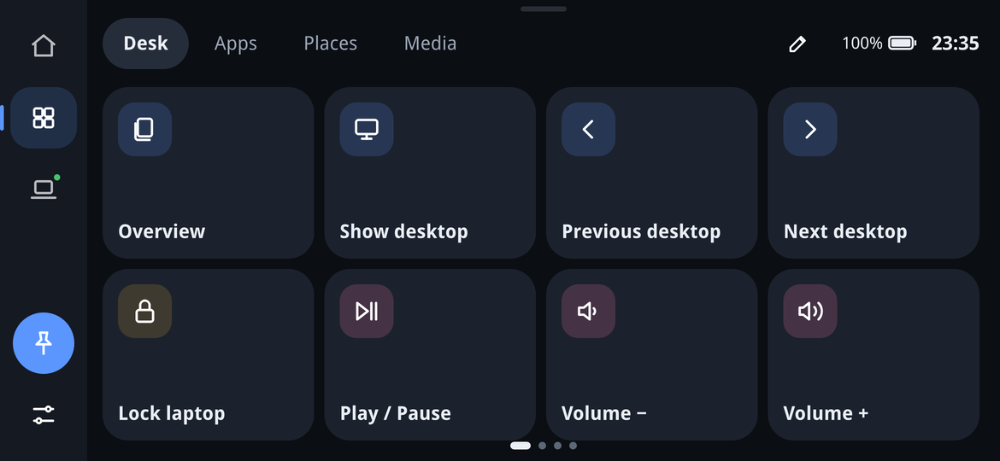
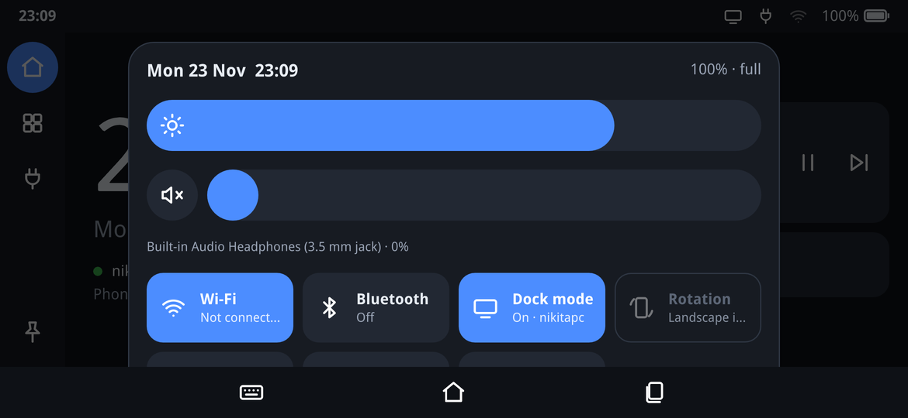
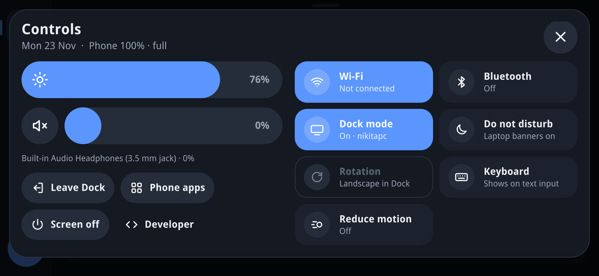
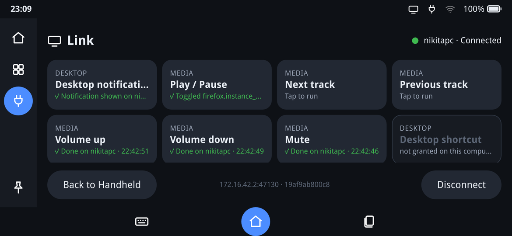
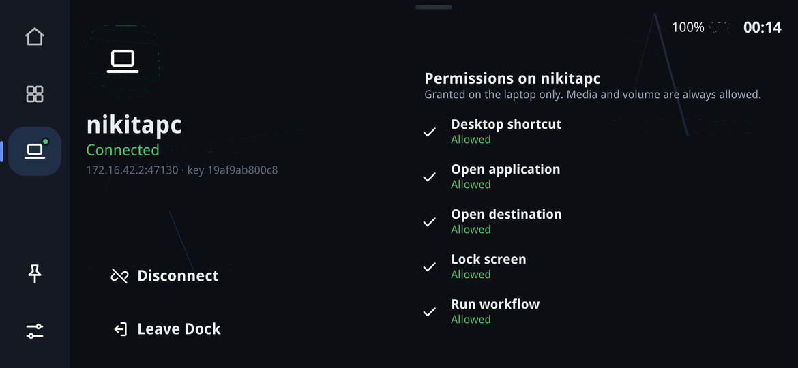

# Stage 4.5 validation: Dock UX overhaul and functional completion

Tracking: [#19](https://github.com/kitnew/Pocket-OS/issues/19) · Decision:
[ADR-0009](../decisions/0009-dock-ux-and-access.md) · UX:
[specification](../dock-mode/ux-specification.md), [design system](../dock-mode/design-system.md)
· Evidence: [`evidence/stage4.5/`](evidence/stage4.5/)

Date: 2026-11-23/24. Everything below was run on the real hardware unless marked.

## Environment

| | |
|---|---|
| Phone | Xiaomi Redmi Note 7 (lavender), postmarketOS edge, Phoc 0.59, Qt 6.12, Quickshell; scale 3 → 780×360 logical landscape |
| Laptop | Fedora 44, KDE Plasma 6.7.5, `nikitapc`, agent as systemd user unit |
| Link | USB networking 172.16.42.0/24, Noise XX |

## How it was driven

Screens were captured with `grim` on the phone. Interactions went through the shell's IPC
(`pocket-ctl ui …`), which calls the same `Shell` functions as touch (tile taps, sheets,
edit mode, navigation). No automated agent touched the glass. The user's own touch pass
of the Stage 4 UI found the problems this stage fixes. The redesigned UI still needs the
manual touch checklist below.

## Problems found and their causes

| Problem | Cause | Fix |
|---|---|---|
| Bars clutter the Dock; time twice | Status (28 px, Top layer) and nav bar (44 px, Overlay layer) always mapped with exclusive zones | `Shell.immersive` unmaps both while the Dock is in front; Dock draws its own status; Controls button + top swipe |
| Quick Settings half clipped in landscape | Single non-scrolling column (~350 px) anchored 36 px down; nav bar drawn over it | Bounded by free space, Flickable, two columns in landscape, momentary actions moved to buttons |
| "Not granted on nikitapc" everywhere | Laptop config had no `grants`/`apps`; grants applied only after restart; no way to ask | Configured the laptop; live reload (SIGHUP); `access.request` (Allow on the laptop); tile kinds distinguish needs-permission / not set up / unavailable |
| Tiles could not show "not set up" | Core did not pass action parameters (choices) to the shell | Core 1.5 `params` key |
| Phone-launched apps could not write to `$HOME` (found during this stage) | Apps were children of the sandboxed agent (`ProtectHome=read-only`) | Transient user services (`systemd-run --user`) |
| Approved grant not saved (found during this stage) | Unit had no writable path for its config | `ReadWritePaths=%h/.config/pocket-desktop-agent` |
| A forgotten details sheet kept the Deck on screen (found by e2e) | Every modal suspended idle return | Informational modals no longer block idle return; idle closes them |
| View switch showed two views mixed | Equal-speed cross-fade | Directional slide; outgoing fades faster |

## Laptop configuration applied (nikitapc)

```
grants        app.launch, desktop.open, desktop.shortcut, session.lock, workflow.run
apps          org.kde.konsole, code, org.kde.dolphin, org.mozilla.firefox,
              org.kde.spectacle, systemsettings, md.obsidian.Obsidian
destinations  pocket-os (VS Code → ~/Storage/Projects/Pocket-OS), projects (Dolphin),
              downloads (Dolphin), repository (Firefox → GitHub)
workflows     start-work: Konsole, then the Pocket OS project in VS Code
notifications forwarding off (unchanged default)
```

Desktop IDs were taken from `/usr/share/applications` and the user's local/flatpak
entries. With this config all 26 tiles of the default deck report `ready`.

## Host actions verified end to end (tile path → laptop → confirmation)

| Tile | Agent evidence | Result |
|---|---|---|
| Overview ×2 (open/close) | `shortcut invoked component="kwin" shortcut="Overview"` | ok |
| Show desktop ×2 | `… shortcut="Show Desktop"` | ok |
| Next / Previous desktop | `… "Switch to Next Desktop"`, `"Switch to Previous Desktop"` | ok |
| Terminal (Konsole) | `apps: launched app=org.kde.konsole`; runs as `app-pocket-dock-org.kde.konsole-….service`, home `rw` | ok |
| Projects (destination) | `desktop.open: opened destination=projects app=org.kde.dolphin` | ok |
| Lock laptop | confirmation sheet opened; **cancelled** (screen not locked) | sheet ok |
| Volume up/down (e2e) | `kmix increase/decrease_volume` | ok |
| KCalc (e2e test policy) | transient unit, writable home, stopped again | ok |
| Ask for access (`session.lock` revoked first) | `access: asked the laptop owner` → `allowed by the laptop owner` 3 s later (clicked on the laptop, not by the test) → tile `ready` without restart | ok; persisting it failed (read-only), fixed and verified writable afterwards |

Media transport was not triggered (it would toggle the user's player). Play/pause was
verified in Stage 4. Its controls are enabled only from the live advertisement.

## Automated results

| Suite | Result |
|---|---|
| `scripts/check.sh` (fmt, clippy `-D warnings`, all Rust tests, shellcheck, node) | all passed |
| node: `navmodel` + `deckmodel` | 23/23 |
| Device: pocketd contract tests (`dbus_contract`, `dock_contract` incl. SetDeck/ResetDeck, params) | 2/2, 16/16 |
| Device: bridge `TstCoreClient` (incl. 1.5 params, access.request choices, setDeck/resetDeck) | 5/5 |
| `scripts/dock-platform-e2e.sh` (Stage 4 + 4.5 sections) | **54/54** ([log](evidence/stage4.5/platform-e2e.txt)) |
| `scripts/dock-e2e.sh` (Stage 3/3.1 regression: agent stop/freeze, core/shell crashes, session restart) | **72/72** ([log](evidence/stage4.5/dock-e2e.txt)) |
| `scripts/e2e.sh stage2` (handheld shell regression) | 56 passed, 0 failed, 1 skipped |

New tests: registry access requests on a private bus with a fake notification server
(allow, deny + cooldown, one prompt at a time, persisted grant), destinations through a
real desktop entry, live reload/revoke, transient-unit argv, config validation, deck
save/round-trip/reset, Core params, deck model (tile kinds, copy, picker, edit ops),
soft-modal navigation.

## Screens (real device, 50 % scale)

| | Before | After |
|---|---|---|
| Home |  |  |
| Deck |  |  |
| Quick Settings (Dock) |  |  |
| Link → Laptop |  |  |

More: [apps page](evidence/stage4.5/after-deck-apps.png), [places](evidence/stage4.5/after-deck-places.png),
[needs permission](evidence/stage4.5/after-needs-permission.png), [confirmation](evidence/stage4.5/after-confirm.png),
[notifications](evidence/stage4.5/after-notifications.png), [edit mode](evidence/stage4.5/after-deck-edit-mode.png),
[tile editor](evidence/stage4.5/after-tile-editor.png), Quick Settings in handheld
[landscape](evidence/stage4.5/after-quicksettings-handheld-landscape.png) and [portrait](evidence/stage4.5/after-quicksettings-portrait.png).

Checked on every capture: no clipping or overlap, all Quick Settings controls reachable
(landscape Dock: all visible; handheld landscape: last row by scrolling, with a fade hint),
touch targets ≥ 44 px (tiles ≈ 180×146, rail 52×48, media 48–52).

## Performance

Idle Dock: no timers except the minute clock and Core's countdown while reconnecting;
spinners run only while a tile is busy and visible. Transitions animate transforms and
opacity only. The Adreno 512 frame time was not measured with a profiler in this stage
(see manual checklist). Shell memory was not re-soaked; the Stage 2.5 soak still applies to
the unchanged runtime.

## Not verified (manual touch checklist)

Each needs a finger on the phone:

1. Swipe sideways between Deck pages, and make sure a quick tap during a swipe doesn't run a tile.
2. Swipe down from the top edge opens Controls; sliders in Controls drag smoothly.
3. Long press (~0.5 s) on a tile opens details; a normal tap still runs it.
4. Edit mode by touch: rename a tile with the on-screen keyboard, check that the editor stays usable with the keyboard up, pick an icon, move a tile to another page, Done.
5. Swipe the notification banner away; swipe a history entry to remove it.
6. Lock laptop → confirm → the laptop locks (not run, to avoid locking the user out).
7. Reduce motion from Controls: transitions become instant.
8. Perceived smoothness of view and sheet transitions on the device.

## Known limitations

- Notification forwarding changes still need an agent restart (privacy boundary).
- The access prompt depends on the laptop's notification server. With Do Not Disturb on, Plasma may hide it.
- #8 (phone-local caller authorization) is unchanged: any program in the phone session can use granted actions or send access requests (requests still need an Allow on the laptop).
- Tile reordering uses move buttons, not drag and drop.
- Media transport was not re-exercised in this stage.
