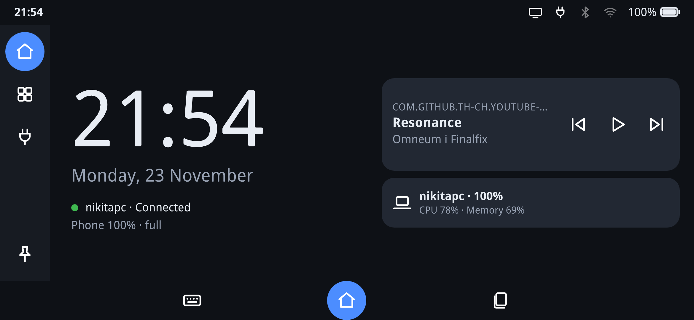
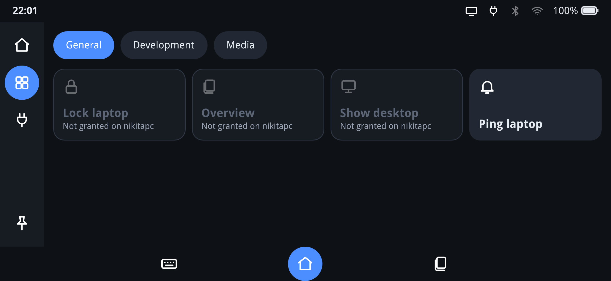
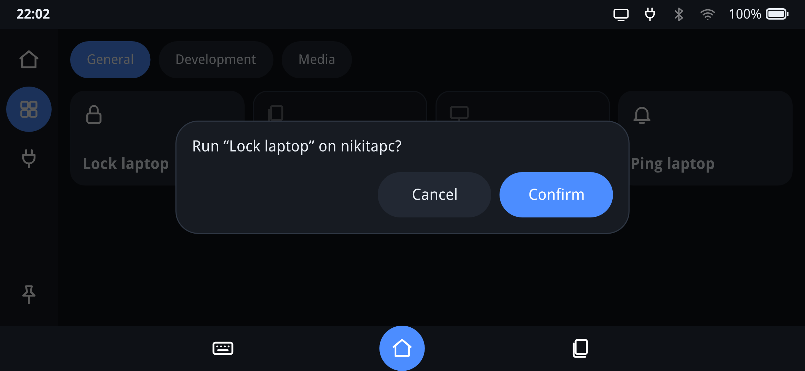
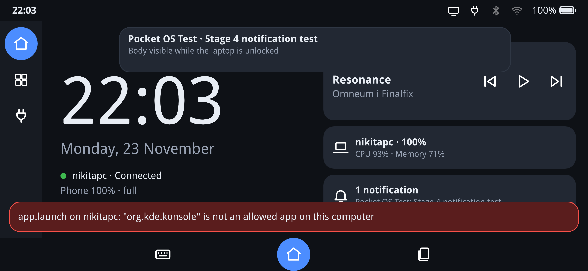
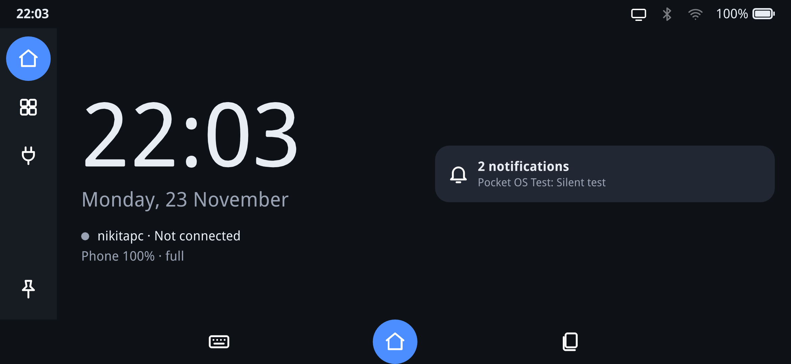

# Stage 4 validation: Dock Mode functional platform

- Date: 2026-11-23
- Baseline: Stage 3.1 `366b08d`. Evidence: `docs/validation/evidence/stage4/`.
- Tracking: [#9](https://github.com/kitnew/Pocket-OS/issues/9) (4.1 [#10](https://github.com/kitnew/Pocket-OS/issues/10),
  authorization [#11](https://github.com/kitnew/Pocket-OS/issues/11), request keys
  [#12](https://github.com/kitnew/Pocket-OS/issues/12), 4.2 [#13](https://github.com/kitnew/Pocket-OS/issues/13),
  4.3 [#14](https://github.com/kitnew/Pocket-OS/issues/14), 4.4 [#15](https://github.com/kitnew/Pocket-OS/issues/15)).
- Design: [`docs/dock-mode/`](../dock-mode/), [ADR-0008](../decisions/0008-dock-platform.md).
  Guide: [`development/dock.md`](../development/dock.md).

## Environment

Unchanged hardware and system: Redmi Note 7 (`lavender`, postmarketOS edge, Phoc 0.59,
Qt 6.12, Quickshell 0.3.2); Fedora 44 + KDE Plasma 6.7.5 (Wayland) with the agent as a
systemd user unit; USB link 172.16.42.1 ↔ 172.16.42.2. No packages, kernel, boot image
or system files changed. Contracts: Core D-Bus **1.3 → 1.4**, Pocket Dock wire
protocol **1.0 → 1.1** (both additive).

## How hardware was driven

Hardware tests ran on the real phone session and the real laptop agent. The phone UI was
driven over Quickshell IPC (`pocket-ctl ui …`), which calls the **same `Shell`
functions** as the rail, tiles and sheets. Nobody touched the screen during this
session: rendering at the real resolution is verified by screenshots, but **finger
input on the new views is not physically verified** (see "Not verified").

## Summary

| Area | Result | How |
|---|---|---|
| 4.1 Ambient Home: clock, date, link, phone battery, real laptop widgets (media, vitals) | **PASS** | hardware screenshots, e2e §1 |
| 4.1 Control Deck from Core's validated deck config (3 pages), tile states, not-granted reasons | **PASS** | hardware screenshots, contract + unit tests |
| 4.1 Navigation: idle return at 15 s, touch resets, pin, modal suspends idle, Core restart keeps the view | **PASS** | 13 node tests; hardware e2e §2, §6, §10 |
| 4.1 Deck config persistence across Core restarts; invalid user file → default + error | **PASS** | contract test `deck_is_validated_reloadable…` |
| 4.1 Physical touch on Home/Deck/sheets | **NOT VERIFIED** | needs a manual pass (checklist below) |
| 4.2 Authorization: privilege classes, grants, closed parameter lists | **PASS** | unit + wire tests; hardware e2e §3, §5, §7 |
| 4.2 Basic actions on KDE (system volume via kglobalaccel) end to end | **PASS (hardware)** | e2e §4 (volume up then down, net zero) |
| 4.2 Elevated action end to end (`app.launch` of a registered app) | **PASS (hardware)** | e2e §7 (KCalc launched and closed); unregistered app → `not_permitted` |
| 4.2 Confirmation sheet; Cancel sends nothing | **PASS (hardware)** | e2e §6 (the lock was never executed) |
| 4.2 `session.lock`, `desktop.shortcut`, `media.next/previous` effects | **PASS (fake services)**; not run on the real desktop | agent tests against fake kglobalaccel/ScreenSaver/MPRIS |
| 4.2 Workflows with progress | **PASS (tests)**; no workflow configured on the real laptop | unit + wire tests |
| 4.2 Request keys: retry after connection loss returns the stored result, never runs twice; retry racing the original waits | **PASS** | agent wire tests; contract test `an_uncertain_request_is_retried…` |
| 4.3 Live state over USB: `host` (lock, battery), `media` (two real MPRIS players), `system` (CPU/memory) | **PASS (hardware)** | e2e §1, screenshots |
| 4.3 No stale state: topics cleared on disconnect, fresh snapshot on reconnect / agent restart / Core restart | **PASS** | contract tests; hardware e2e §9, §10 |
| 4.3 1.0 agent still works (no subscribe) | **PASS** | contract test `a_1_0_agent_still_works…` |
| 4.4 Notifications: monitor, allow/deny, no echo, redaction while locked, close sync | **PASS** | agent tests (real `BecomeMonitor` on a private bus) |
| 4.4 Real Fedora notification → phone banner; filtered app not forwarded; DND = history only | **PASS (hardware)** | e2e §8; agent log shows only the two allowed test notifications |
| 4.4 Preferences (DND, muted apps) persist across Core restarts | **PASS** | contract test |
| Stage 3/3.1 regression (`scripts/dock-e2e.sh`) | **PASS** (72/72 after fixing a test-timing tolerance) | see below |
| Rust (96), node (13), clippy, fmt, shellcheck, qmllint (device), device contract (17) + bridge (5) tests | **PASS** | `scripts/check.sh`, `scripts/test-device.sh` |

## Automated results

| Suite | Result |
|---|---|
| `scripts/check.sh` (host): fmt, clippy `-D warnings`, 96 Rust tests (protocol 10, agent 13 unit + 22 wire/integration, pocketd units incl. deck 4 + prefs 3, D-Bus contract 2, Dock contract 15), shellcheck, node 13 | all passed |
| `scripts/test-device.sh` (aarch64 on the phone): contract 2 + 15, `tst_coreclient` 5 (incl. Core 1.4 members) | all passed |
| qmllint on the device (components, features, state, theme) | clean |

## Hardware: `scripts/dock-platform-e2e.sh`

[`evidence/stage4/platform-e2e.txt`](evidence/stage4/platform-e2e.txt): **42 passed, 0
failed** (~3 min). The script temporarily installs a narrow test policy on the laptop
(grants `session.lock` and `app.launch`, one registered app, notifications only from the
app name "Pocket OS Test") and restores the original configuration on exit.

| Ambient Home | Control Deck |
|---|---|
|  |  |

| Confirmation sheet (modal) | Notification banner + toast for a refused app |
|---|---|
|  |  |

Disconnected: remote widgets gone, phone-local history kept:

First run: 40/42 — both failures were this laptop's broken `notify-send` (a libnotify
symbol mismatch), so no notification was sent; the script now calls
`org.freedesktop.Notifications.Notify` with `gdbus`.

## Stage 3/3.1 regression

[`evidence/stage4/stage3-regression-dock-e2e.txt`](evidence/stage4/stage3-regression-dock-e2e.txt):
**72 passed, 0 failed** on the final code. A first run had 71/72: §10d "countdown
decreases with the clock" assumed the two samples were ~2 s apart, but each sample is an
SSH + IPC round trip, and the larger Stage 4 IPC state made it slower (2713 ms > 2700 ms).
The neighbouring checks that compare the shown countdown with Core's deadline passed.
The check now compares the decrease with the host time that really elapsed. Recovery,
Disconnect sticking, keepalive, core crashes and the session restart passed unchanged.

## Not verified (manual checklist)

1. **Touch pass** on the phone in Dock Mode: rail buttons, pin, page chips, tile tap
   feedback (pressed state), confirmation sheet buttons, notification history sheet
   (DND toggle, Mute app, Clear, close), media widget buttons. Check that a touch on any
   view resets the 15 s idle return (the `PointHandler` path; IPC used `interact()`).
2. `session.lock` with Confirm on the real laptop (the e2e only cancels).
3. `desktop.shortcut` (overview, show desktop, next/previous desktop) on the real KDE.
4. A workflow defined in the laptop's `config.json` (progress on the tile).
5. Notification body redaction while the laptop is really locked.
6. USB cable pulled **during** an action, then Retry from the tile (covered by contract
   tests with a dropped connection; not physically).

## Known limitations

- Phone-local callers are still one trust domain ([#8](https://github.com/kitnew/Pocket-OS/issues/8)):
  any program in the phone session can trigger granted actions and read forwarded
  notifications. Defaults keep Stage 3.1's exposure (no grants, forwarding off).
- The agent's dedup cache is in memory: a Retry after an agent restart may run the
  action again (the UI words it that way for non-idempotent actions).
- No active-application or running-task source (widgets hidden); no notification
  actions; no in-UI deck editing ([#17](https://github.com/kitnew/Pocket-OS/issues/17));
  no predefined destinations ([#16](https://github.com/kitnew/Pocket-OS/issues/16)).
- Notification history lives in the shell (cleared on a shell restart).
